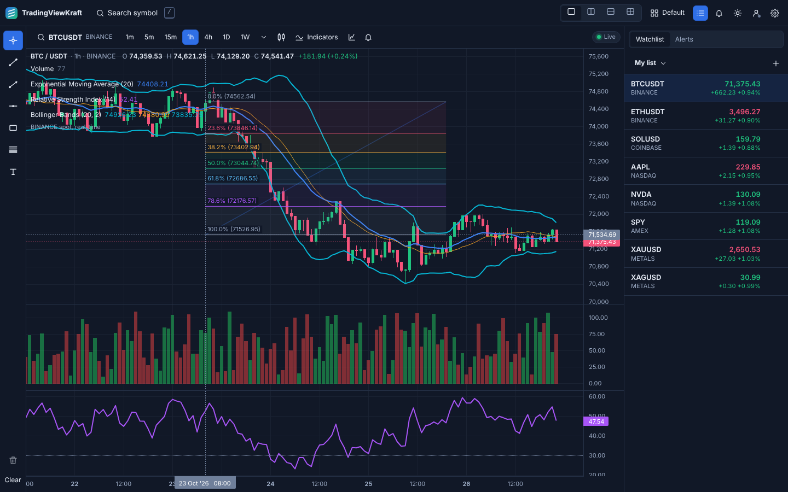

# TradingViewKraft

A clean-room, TradingView-style charting app for **crypto, US stocks and gold/silver** that runs as:

- a **native macOS app** (Tauri 2, bundling the same frontend build),
- an **installable PWA** on iPhone and iPad (Safari → Add to Home Screen),
- a **web app** in any desktop browser,

entirely on **free tiers**: Vercel Hobby (static hosting + Functions), Supabase Free (auth + Postgres sync) and free
market-data plans (public exchange streams, Alpaca free, Twelve Data free). No always-on server.



## What v1 does

| Area | Details |
| --- | --- |
| Chart | Candles, bars, line, area, Heikin Ashi · 1m–1M timeframes · zoom/pan/crosshair · price & time scales · log scale |
| Live data | Streaming prices update the open candle in real time; reconnect with backoff, resubscribe and backfill gaps |
| Assets | Crypto (Binance, Coinbase, Kraken, Bybit, OKX), US stocks (Finnhub + Twelve Data, or Alpaca/IEX if you have US keys), gold & silver spot (Twelve Data) plus tokenized gold (PAXG/XAUT) |
| Symbols | `EXCHANGE:SYMBOL` everywhere: `BINANCE:BTCUSDT`, `NASDAQ:AAPL`, `METALS:XAUUSD`; search with filters and exchange prefixes |
| Watchlist | Live price, change and % change; multiple lists |
| Indicators | SMA, EMA, VWAP, Bollinger Bands, RSI, MACD, Volume (own implementation, unit-tested) |
| Drawings | Trend line, ray, horizontal line, rectangle, Fibonacci retracement, text — mouse, touch and Apple Pencil |
| Layouts | 1, 2 and 4 charts on Mac/iPad; single chart with quick switching on iPhone; saved layouts |
| Alerts | Price alerts while the app is open: macOS notifications (Tauri), Web Notifications + in-app toasts on iPhone/iPad |
| Sync | Layouts, watchlists, alerts and settings synced through your Supabase account (magic-link sign-in), local-first |
| Themes | Dark and light, WCAG-checked tokens |

Out of scope for v1 (planned for v2): Pine Script, social/ideas, broker trading, news, screeners, options, alerts while the app is closed.

## Repository layout

```
apps/web                 React + Vite app (web, PWA and the Mac app's frontend)
apps/web/api             Vercel Functions: stock relay (Alpaca), metals relay (Twelve Data), CORS proxy, health
apps/desktop             Tauri 2 macOS shell (Rust) bundling apps/web/dist
packages/shared-types    Symbol / tick / candle / provider interfaces, persisted models
packages/market-data     Exchange + provider adapters, candle builder, reconnecting WebSocket, symbol normalization
packages/chart-core      Indicator math, drawing geometry, timeframe helpers
packages/ui              Design tokens (dark/light), icons, primitives
supabase/                SQL migration with row-level security
replica/                 Recon, architecture, design, build, backend, test and parity reports (+ screenshots)
docs/decisions.md        Decision log, including the free-tier limits we rely on
```

## Setup

Requirements: Node 22, pnpm 10 (`corepack enable`), and for the Mac app Rust + Xcode Command Line Tools.

```bash
pnpm install
cp apps/web/.env.example apps/web/.env     # fill in what you have; everything is optional for a first run
```

Environment variables are documented in `apps/web/.env.example`: `VITE_*` values are safe for the client,
everything else (`ALPACA_*`, `TWELVEDATA_API_KEY`) is server-side only and lives in Vercel's project settings.

## Run the web app locally

```bash
pnpm dev                 # http://localhost:5173 — live crypto works without any keys
pnpm --filter @tvk/web dev:mock   # deterministic simulated data for every asset class (offline)
```

Stocks and metals need the relay functions. Run them locally with the Vercel CLI from `apps/web`
(`npx vercel dev`) with the server-side variables set, or point `VITE_RELAY_BASE` at a deployed preview.

Add `?mock=1` to any URL to switch to simulated data at runtime.

## Run the Mac app

```bash
pnpm desktop:dev         # Vite + native window
cp apps/desktop/.env.example apps/web/.env.desktop && $EDITOR apps/web/.env.desktop   # VITE_RELAY_BASE = your Vercel URL
pnpm --filter @tvk/desktop icons   # one-time: icon.icns / icon.ico (already committed)
pnpm desktop:build       # .app and .dmg in apps/desktop/src-tauri/target/release/bundle/
```

See `apps/desktop/README.md` for prerequisites and why Tauri (not Electron).

## Install the PWA on iPhone / iPad

1. Open the deployed URL in **Safari** (not Chrome; only Safari can install PWAs on iOS).
2. Tap **Share → Add to Home Screen → Add**.
3. Launch from the Home Screen. It runs full-screen with safe-area padding; pinch to zoom the chart,
   drag to pan, long-press/tap-tap with a finger or Apple Pencil to draw.
4. For alert notifications: Settings (in the app) → **System notifications** → allow. iOS only offers the
   prompt to apps added to the Home Screen (iOS 16.4+). Alerts fire while the app is open; iOS suspends
   sockets in the background, the app reconnects and backfills when you come back.

## Deploy to Vercel (Hobby)

1. Import the GitHub repo in Vercel. **Root Directory: `apps/web`** (the `vercel.json` there configures the
   pnpm workspace install, the Vite build and the Functions' max duration). Framework preset: Vite.
2. Environment variables (Project → Settings → Environment Variables):
   `FINNHUB_API_KEY`, `TWELVEDATA_API_KEY`, `VITE_SUPABASE_URL`, `VITE_SUPABASE_ANON_KEY`
   (optionally `ALPACA_KEY_ID`, `ALPACA_SECRET_KEY`, `ALPACA_FEED=iex` to use Alpaca instead of Finnhub).
   Leave `VITE_RELAY_BASE` empty (same origin).
3. Production deploys from `main`; every other branch gets a preview URL.
4. Check `https://<your-app>.vercel.app/api/health` → `{ ok: true, stocks: true, metals: true }`.

Binance traffic never goes through Vercel (Binance blocks datacenter IPs with HTTP 451); all crypto data
is fetched directly by the client. Only the stock and metals relays (secret keys) and an allow-listed CORS
proxy run as Functions.

## Supabase (Free)

Create a project, enable Email (magic link) auth, run `supabase/migrations/0001_init.sql`, and copy the URL and
anon key into the `VITE_SUPABASE_*` variables. Details and the inactivity-pause caveat: `supabase/README.md`.

## Tests

```bash
pnpm test                          # unit tests: candle building, indicator math, symbol normalization, alerts, store
pnpm typecheck
pnpm --filter @tvk/web test:e2e    # Playwright: desktop, iPad and iPhone projects against a local preview (mock data)
E2E_BASE_URL=https://<preview>.vercel.app pnpm --filter @tvk/web test:e2e   # same suite against a Vercel preview
E2E_WEBKIT=1 pnpm --filter @tvk/web test:e2e                                 # WebKit engine for the iPad/iPhone projects (macOS)
python3 scripts/contrast.py        # WCAG contrast check of the design tokens
```

## Status

See `replica/status-report.md` for what works on each platform, the parity score, open bugs and next steps.
